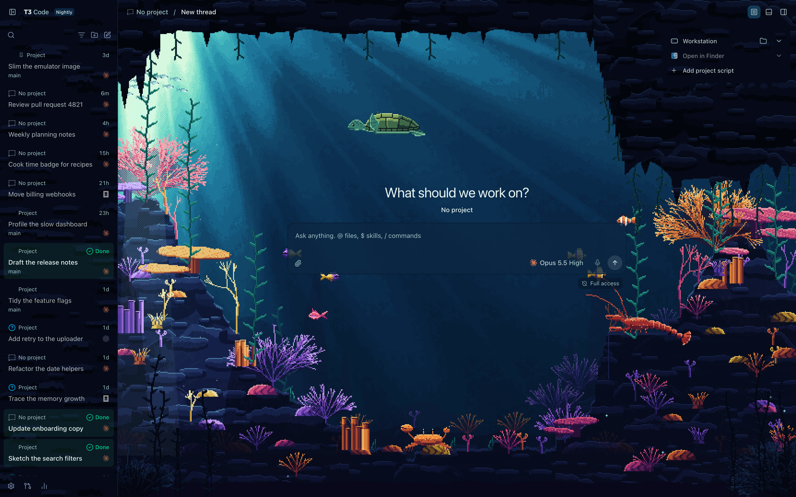
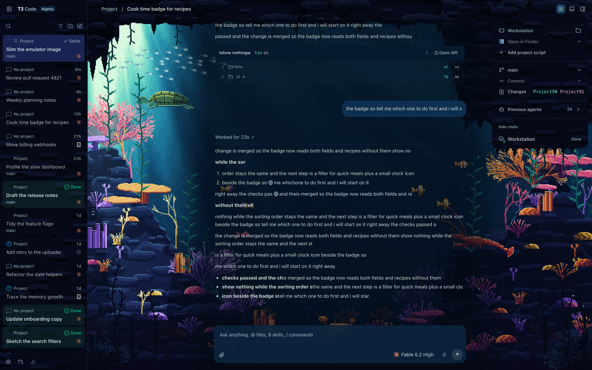

# Coral Reef

An animated pixel-art reef for T3 Code. A turtle crosses shafts of light, sardines pass over swaying kelp, a crab patrols the sand, and the whole app is cut from the same cave rock: sidebar, top bar, panels, menus and dialogs.

## Install

Download [`coral-reef.json`](coral-reef.json), then either:

- run `t3 theme set coral-reef.json`, or
- add it from Settings, Appearance, Add a theme.

Dark mode only.

## What it does

- The reef is drawn behind your conversation and scales in whole pixels, so the art stays crisp from a laptop to an ultrawide display.
- A shade under the text column keeps body text readable over the art at every window size.
- The top bar continues the cave roof. The thread details card hangs from it like a ledge.
- With "reduce motion" switched on in your system settings, the animals are left out and you get a still reef.
- There is one rare visitor. Leave a thread open for a few minutes.

## How it is built

The whole theme is one JSON file with no external loads. The still artwork is an embedded colour font (COLRv1, WOFF2), the animals are a single inline SVG, and the light is a stack of CSS gradients. It fits inside T3 Code's 50,000 character limit for theme CSS.

## Performance

Measured in Chrome against T3 Code with no theme, at a 1920 by 1080 window on a high-density display:

- Opening menus and typing cost the same as with no theme.
- Switching threads takes about 8% longer.
- The motion runs at 60 frames a second and uses about 8% of one processor core while a conversation is on screen. With "reduce motion" on, it uses none.
- Resizing the window, or showing and hiding the sidebar or the side panel, redraws the reef. Expect a hitch of about a fifth of a second each time.

## Known limits

- Dark appearance only.
- Tested on T3 Code for macOS. The theme relies on a few of the app's internal attributes, so a future app update may need a theme update.

## License

MIT. See [LICENSE](LICENSE).
