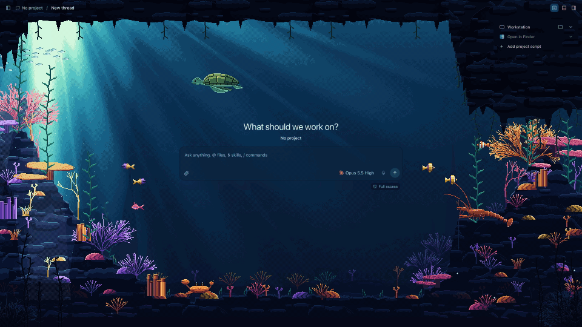

# Coral hand-coding spec

A sheet for the follow-up work on the Coral theme. The theme file, readme, and media on `main` stay as they are until you edit them. Measurements below are against `700f78c` (22 Nov 2026), T3 Code `main` (`packages/shared/src/themePalettes.ts`, `packages/contracts/src/server.ts`, `apps/web/src/themePalette.ts`), and the public catalog at t3skins.dev.

Work in this order. Sections 1 and 2 touch only `id` and `colors`. Sections 4 and 5 are the first edits that change the `css` string, and they do not fit in the 42 characters left under the old 50,000 cap.

1. Add `"id": "coral"` and write the colour roles in section 1 and section 2.
2. Fix the readme (the 50,000-character claim, reduced motion, the agent prompt) and swap the media.
3. Add `SKILL.md` from the outline in section 7.
4. Decide the 700px rule: reclaim 33 characters in the default CSS, or ship it only in `coral-extended.json`.
5. Build `coral-extended.json` for the open-water art, then test the browsers in section 9 and list the finished file on t3skins.dev.

## 1. The 17 missing colour roles

### Problem

`coral.json` sets 44 of the 61 official roles. T3 fills every omitted role from `canvas` and `accent` via `createVividThemeColors` in `parseThemeFile` (`apps/web/src/themePalette.ts`). Those generated colours are not the cave palette, so error, warning, search, and the terminal chrome drift.

### Evidence

`THEME_COLOR_ROLES` in `packages/shared/src/themePalettes.ts` is 61 names. The file's `colors` object has the 44 names listed as "unchanged" in the palette appendix, and none of the 17 below. An unknown name makes `parseThemeFile` throw. A known name that you leave out is filled from `#06172c` and `#7fe3e8`.

### Proposed values

Text contrast is WCAG 2.x relative luminance, `(Lighter + 0.05) / (Darker + 0.05)`. AA for normal text is 4.5:1. Non-text UI (SC 1.4.11) is 3:1. Ratios are against the colour that role is actually painted on. `terminalBackground` is `#060a18` and stays put.

| Role | Hex | Painted on | Ratio |
| --- | --- | --- | --- |
| `error` | `#f07178` | `errorSurface` `#2a1218` | 6.12 |
| `error` | `#f07178` | `canvas` `#06172c` | 6.29 |
| `errorForeground` | `#ff9aa0` | `errorSurface` `#2a1218` | 8.66 |
| `errorSurface` | `#2a1218` | fill behind the error text | — |
| `warning` | `#e6c84a` | `warningSurface` `#2a2210` | 9.53 |
| `warning` | `#e6c84a` | `canvas` `#06172c` | 10.91 |
| `warningForeground` | `#ffe08a` | `warningSurface` `#2a2210` | 12.20 |
| `warningSurface` | `#2a2210` | fill behind the warning text | — |
| `update` | `#7fe3e8` | `updateSurface` `#123a55` | 7.98 |
| `update` | `#7fe3e8` | `canvas` `#06172c` | 12.05 |
| `updateForeground` | `#a6f0f2` | `updateSurface` `#123a55` | 9.29 |
| `updateSurface` | `#123a55` | fill behind the update text | — |
| `searchMatchForeground` | `#e6f2f0` | `searchMatchBackground` `#3a5a40` | 6.75 |
| `searchMatchBackground` | `#3a5a40` | the inactive match mark | — |
| `searchMatchActiveForeground` | `#041018` | `searchMatchActiveBackground` `#7fe3e8` | 12.87 |
| `searchMatchActiveBackground` | `#7fe3e8` | the active match mark | — |
| `terminalCursor` | `#7fe3e8` | `terminalBackground` `#060a18` | 13.21 |
| `terminalForeground` (unchanged `#e6f2f0`) | `#e6f2f0` | `terminalSelection` `#1a4a68` | 8.24 |
| `terminalSelection` | `#1a4a68` | `terminalBackground` `#060a18` | 2.09 |
| `terminalScrollbar` | `#1a3050` | `terminalBackground` `#060a18` | 1.49 |
| `terminalScrollbarHover` | `#2a4a6a` | `terminalBackground` `#060a18` | 2.15 |

Every text pair clears 4.5:1. The cursor clears 3:1. The selection highlight and both scrollbar colours stay under 3:1 against the terminal background, on purpose: they are cave blues, and the text on the selection is 8.24:1. `terminalScrollbarHover` against `terminalScrollbar` is 1.44:1, so the hover state is a small step. Leave these four as they are unless a terminal pass shows the selection or the scrollbar disappearing.

`update` and `updateForeground` reuse the accent cyan. `updateSurface` reuses the old `accentSurface` (`#123a55`). The active search pair reuses accent on `#041018`, the same pair as `accent` / `accentForeground` (12.87:1).

### Where

Inside `colors` in `coral.json`. Append the 17 keys after `terminalForeground`. JSON key order does not matter. Top-level `canvas` (`#06172c`) and `accent` (`#7fe3e8`) stay; they are the seeds, and the matching `colors` entries stay too.

Also add a top-level `"id": "coral"`, between `version` and `name`:

```json
{"version":1,"id":"coral","name":"Coral","appearance":"dark","canvas":"#06172c","accent":"#7fe3e8","colors":{ ... },"css":"..."}
```

### How to implement

`parseThemeFile` accepts `id` when it matches `^[a-z0-9](?:[a-z0-9-]{0,47})$` and is not reserved (`system`, `light`, `dark`, `t3-chat`, `grove`, `ocean`, `ember`, `iris`, and the legacy aliases `t3-chat-dark`, `t3-grove`, `t3-ocean`, `t3-ember`, `t3-iris`). `coral` passes.

The server schema `EnvironmentThemeFile` does not declare `id`. Effect Schema strips unknown keys (`onExcessProperty` defaults to `"ignore"`), and `t3 theme set coral.json` takes the id from the filename. The field is for the web importer and for anyone reading the file. Keep the filename `coral.json`.

Edit `colors` in place. The parsed `css` string stays the 49,958-character value already in the file (SHA-256 `b1741450286ca2798b1adaf467f9f456b74b88da9919975d7b1d159c6be8d7ee`). The file is one line, no trailing newline, and the CSS contains the Greek scale variables (`α` through `ω`, plus `ϑ`). `json.dumps(obj, ensure_ascii=False, separators=(",", ":"))` round-trips the current file exactly. `ensure_ascii=True` rewrites those letters as `\u` escapes. The parsed CSS is the same either way; the diff is not.

`colors` values are trimmed strings up to 64 characters. `#rrggbb` passes. `canvas` and `accent` at the top level must match `#rgb` or `#rrggbb`.

### How to verify

- The script at the bottom of this file passes.
- In T3 Code, dark appearance: an error and a warning use the new reds and golds, not a generated violet. Find-in-page shows a green inactive mark and a cyan active mark. The terminal cursor is the accent cyan, the selection is the deep blue, and the scrollbar is the cave blue and lightens slightly on hover.
- `t3 theme set coral.json` still publishes the theme as `coral`.

## 2. Sidebar rows, borders, and messageSurface

### Problem

The sidebar states sit almost on the sidebar fill, the borders sit almost on the panels they divide, and the user bubble sits almost on the water. Text on these fills is already readable. The gap is between neighbouring surfaces.

### Evidence

Same contrast formula as section 1. Sidebar fill `#060a18`, sidebar text `#e8eef2`, muted sidebar text `#a3b3d6`. Body text `#e6f2f0`. Neighbouring surfaces: `surface` `#071b30`, `canvas` `#06172c`, `toolbar` `#050f1c`.

Row fill against the sidebar:

| State | Before | Ratio | After | Ratio |
| --- | --- | --- | --- | --- |
| `sidebarRowHover` | `#151d44` | 1.21 | `#2c3c8d` | 2.01 |
| `sidebarRowActive` | `#1a2452` | 1.33 | `#323ea0` | 2.19 |
| `sidebarRowSelected` | `#1f2b60` | 1.48 | `#3d54bd` | 3.01 |

Selected just clears the 3:1 non-text bar. Hover and active get stronger and still sit under 3:1. Reaching 3:1 on those two would make them about as light as the selected blue, and the three steps would collapse.

Text on the new row fills:

| Text | On hover `#2c3c8d` | On active `#323ea0` | On selected `#3d54bd` |
| --- | --- | --- | --- |
| `#e8eef2` before → after | 13.90 → 8.39 | 12.65 → 7.69 | 11.41 → 5.60 |
| `#a3b3d6` before → after | 7.73 → 4.67 | 7.03 → 4.28 | 6.34 → 3.12 |

`sidebarForeground` stays above 4.5:1 on every new state. `sidebarMutedForeground` stays above 4.5:1 on the new hover (4.67) and drops below it on the new active (4.28) and the new selected (3.12). There is one muted role for the whole sidebar, so a selected-row label in the muted colour is normal-size text under AA.

Borders and the bubble, against the surface they sit on:

| Edge | Before | Ratio | After | Ratio | Against |
| --- | --- | --- | --- | --- | --- |
| `border` | `#153a55` | 1.46 | `#1c4d71` | 1.94 | `surface` `#071b30` |
| `border` | `#153a55` | 1.52 | `#1c4d71` | 2.01 | `canvas` `#06172c` |
| `toolbarBorder` | `#0b2a3d` | 1.29 | `#13496a` | 2.01 | `toolbar` `#050f1c` |
| `sidebarBorder` | `#03050d` | 1.03 | `#1a2048` | 1.26 | `sidebar` `#060a18` |
| `messageSurface` | `#0e3050` | 1.33 | `#16405c` | 1.65 | `canvas` `#06172c` |

None of these edges reach 3:1. A 3:1 line would be much lighter than the cave rock. The change is a visibility nudge. Body text on `messageSurface` goes from 11.77:1 to 9.53:1, still AA. `textMuted` `#9fc2c4` on the new bubble is 5.72:1.

The reviewed palette also moves `accentSurface` from `#123a55` to `#184d71`. Text `#e6f2f0` on it goes from 10.40:1 to 7.83:1. Separation from `canvas` goes from 1.51:1 to 2.00:1. Take it if you copy the whole palette; the named fixes above do not depend on it.

### Where

The same `colors` object. Keys that already exist: change the hex in place. Do not add a second copy of the key.

### How to implement

Set:

- `sidebarRowHover` to `#2c3c8d`
- `sidebarRowActive` to `#323ea0`
- `sidebarRowSelected` to `#3d54bd`
- `border` to `#1c4d71`
- `toolbarBorder` to `#13496a`
- `sidebarBorder` to `#1a2048`
- `messageSurface` to `#16405c`
- `accentSurface` to `#184d71` if you want the reviewed palette rather than the seven fixes alone

Leave `sidebarMutedForeground` at `#a3b3d6` to match that palette. If muted labels on the selected row have to clear 4.5:1, lighten that one role instead of backing off the selected blue. `#d0d9e8` (about two-thirds of the way from `#a3b3d6` to `#e8eef2`) is 4.61:1 on `#3d54bd`, 6.33:1 on `#323ea0`, and 13.88:1 on the sidebar fill. That alternative is not in the reviewed palette.

The `css` string stays untouched in this step. Row colours are roles, and the sidebar is not painted by the reef CSS.

### How to verify

- The check script passes, including the seven hexes.
- Hover, active, and selected rows read as three steps of the same blue, and selected is the obvious one.
- A muted sidebar label on a selected row is the one to look at. At `#a3b3d6` it will be the faintest text on the bar.
- Panel edges and the toolbar rule are visible against the cave and still darker than the text.
- A user message on the reef is a distinct ledge, and the message text still looks white.

## 3. The CSS cap, and `coral-extended.json`

### Problem

The readme says the theme fits T3 Code's 50,000-character CSS limit. That limit moved.

### Evidence

`THEME_CSS_MAX_LENGTH` in `packages/contracts/src/server.ts` is `100_000`. [pingdotgg/t3code#37781](https://github.com/pingdotgg/t3code/pull/37781) merged on 17 Nov 2026 and raised it from 50,000. The theme schema, the web editor, and `t3 theme set` all read that constant. The PR notes that a client on an older build drops CSS longer than its own limit and still applies the colours.

The parsed `css` string in `coral.json` is 49,958 characters. Room under the old cap is 42 characters. Room under the new cap is 50,042 characters.

### Proposed change

Keep the default file's parsed CSS at 49,958 characters so an old client still draws the reef. Put anything that needs the new budget in a second file, `coral-extended.json`, with `"id": "coral-extended"` and the same `colors` once section 1 and section 2 are done. Its `css` may grow to 100,000 characters and no further.

### Where

`coral.json`: the `css` string, left byte-for-character as parsed today.

`coral-extended.json`: a sibling of `coral.json`. Same shape (`version`, `id`, `name`, `appearance`, `canvas`, `accent`, `colors`, `css`). `name` can be `Coral` or `Coral Extended`; either is under the 48-character label cap. The filename is the id `t3 theme set` publishes.

### How to implement

Copy `coral.json` only after the palette edit, then change `id` and extend `css`. Old clients that load the extended file keep the colours and drop the CSS once it passes 50,000 characters. Say that next to the file.

Suggested readme replacement for the current "50,000 character limit" sentence:

> The whole theme is one JSON file with no external loads. The still artwork is an embedded colour font (COLRv1, WOFF2), the animals are a single inline SVG, and the light is a stack of CSS gradients. It fits inside T3 Code's original 50,000-character CSS cap, so older clients still get the art.
>
> Current T3 Code allows 100,000 characters of theme CSS (raised on 17 Nov 2026). This file stays under 50,000 so a client that has not updated does not drop the CSS. There is about 50,000 characters of room for a richer cut of the reef if you are happy to require a current client.

Point `coral-extended.json` at that second sentence. The default file on disk is 51,376 bytes today and about 51.9 KB after the palette edit. "52 KB" is a fair rounded size for the default file. Compare skins by CSS characters, which is what the cap counts (section 11).

### How to verify

- `len(css)` on `coral.json` is 49,958 and the SHA-256 above matches.
- `len(css)` on `coral-extended.json` is greater than 49,958 and at most 100,000.
- On a current build, both files draw the reef. On a build from before 17 Nov 2026, `coral.json` still draws it and `coral-extended.json` keeps the colours with the stock background.

## 4. Open water

### Problem

The middle of the conversation is a large empty cave. The animals that exist are a turtle, one sardine school, kelp, a crab, small fish, and a pink jellyfish. The jellyfish is the rare visitor.

### Evidence

The animals are one inline SVG on `.chat-banner-lane::before`, nested under `.dark [data-chat-canvas]`. The still reef is the COLRv1 font `Reef` (glyphs `a`–`e`, axes `WIDE` and `TALL`) on the other pseudos. The light is CSS gradients plus one `feColorMatrix` and a discrete `feComponentTransfer`. The CSS has no `blur(`. It sets `backdrop-filter: none` on the chrome.

The jellyfish rule is `@keyframes J` over `240s`. Opacity is 0 until 84%, about 0.92 at 86%, and 0 again at 88%. That is about ten seconds, once per loop, starting a little after the three-minute mark (84% of 240s is 201.6s). The readme's "leave a thread open for a few minutes" is this loop.

The readme's timing pass (one Mac, headless Chrome, 1920×1080, high-density, no theme as the baseline) puts a resize, or a sidebar or side-panel toggle, at about a fifth of a second. The reef redraws because the variable colour font and the full-size SVG filter repaint. Motion otherwise runs at 60 fps and about 8% of one core.

### Proposed change

In `coral-extended.json` only, add life in the open water:

- bubbles rising through the empty middle
- a seahorse or an eel along the kelp
- a second, smaller school, higher and slower than the sardines
- one distant silhouette, low contrast, near the far reef
- a longer jellyfish visit, by widening the 84–88% window in `@keyframes J` rather than adding a second animation

Draw them as more shapes in the existing SVG, in the same pixel grid. Leave `blur()` out. Leave a second full-viewport SVG filter out. The resize cost is already spent on the font and the one filter.

### Where

The `css` string of `coral-extended.json`, inside the SVG `url("data:image/svg+xml,...")` that is the background of `>.chat-banner-lane::before`. The jellyfish timing is `@keyframes J` in that SVG's `<style>`. New groups follow the existing classes (`c` crab, `J` jellyfish, `K` the repeated fronds that use `sibling-index()`).

Reduced motion already removes this whole layer (section 6). New animals inherit that, because they live on the same `::before`.

### How to implement

Start from the default CSS so the extended file is a superset. Add groups. Keep `steps()` timing so the pixel art stays on whole pixels. A distant silhouette is a low-opacity shape, not a blur. A longer jellyfish is a wider band in the same 240s keyframes (for example 78% through 92%, which is still one visit per loop).

Budget: 50,042 characters above the current string, and the extended file stops at 100,000. Count `len(css)` after each addition. `@import`, `image-set()`, and `url()` other than `data:` or `#id` are stripped, and `t3 theme set` refuses CSS that loads remote files.

### How to verify

- The default file's CSS hash is unchanged.
- The extended file is at most 100,000 characters and still has one `feColorMatrix`.
- `blur(` does not appear.
- On the start screen and in a conversation, the new shapes sit in the empty water and the existing animals still loop.
- Resize the window and toggle the sidebar. Expect the same hitch, about a fifth of a second, and not a second hitch from a new filter.
- With reduced motion on, the new animals are gone with the old ones, and the still reef and the light shafts remain.

## 5. The 700px breakpoint

### Problem

Under 393px the crab (`.c`) is hidden, and under 370px the jellyfish (`.J`) is hidden. Both tests are viewport `@media` rules inside the SVG stylesheet. A split pane can be ~700px wide while the window is much wider, so those queries never match, and the animals keep running in a narrow column. The side pane is already covered: `[data-side-chat-pane] [data-chat-canvas]` hides the reef pseudos.

### Evidence

```css
@media(max-width:393px){.c{display:none}}
@media(max-width:370px){.J{display:none}}
```

Those two rules are inside the SVG `<style>`. An SVG background does not see the page's container. The page container is `.dark [data-chat-canvas] { container: reef / size }`, and `>.chat-banner-lane::before` is a child of that element, which is why `100cqw` works for the reef scale.

The default CSS has 42 characters of room under 50,000. A container query that hides the animal layer is 75 characters:

```css
@container reef (max-width:700px){>.chat-banner-lane::before{display:none}}
```

75 − 42 = 33. It does not fit in `coral.json` unless 33 characters come out of the existing string.

### Proposed change

Hide the animal layer when the reef container is 700px or narrower. Leave the still reef and the light. Prefer this on `coral-extended.json`, where the budget exists. On `coral.json`, add it only after deleting at least 33 characters from the current CSS and re-checking the hash of everything you meant to keep.

### Where

In the document CSS, next to the reduced-motion rule, still nested under `.dark [data-chat-canvas]`:

```css
@media(prefers-reduced-motion:reduce){>.chat-banner-lane::before{display:none}}
```

A `@container` inside the SVG `<style>` does not see `reef`. A viewport `@media (max-width: 700px)` does not see a split pane.

### How to implement

Add the 75-character query as a sibling of the reduced-motion rule. 700px is the threshold to try; if a real split pane lands nearer 640px or 760px, change the number and look again. Do not also hide glyphs `a` and `b`. Those are the still reef, and the side-pane rule is the one that removes the whole scene.

### How to verify

- A full-width window still shows the animals.
- Drag a split until the conversation column is under 700px and the window is wider than 700px. The animals go; the cave, the reef, and the light shafts stay.
- The side pane still hides the reef, as it does today.
- The 393px and 370px rules still hide the crab and the jellyfish when the whole window is that narrow.
- `len(css)` for whichever file you edited is within that file's cap (50,000 or 100,000).

## 6. Reduced motion, in the readme

### Problem

The readme says reduced motion leaves the animals out and leaves a still reef. It does not say the light shafts stay, and the performance note says "the motion is not drawn", which sounds like the whole scene stops.

### Evidence

The only reduced-motion rule in the CSS is:

```css
@media(prefers-reduced-motion:reduce){>.chat-banner-lane::before{display:none}}
```

That pseudo holds the animal SVG. The still reef is the colour font on the other pseudos. The light shafts are gradients on the canvas. Neither is inside this rule.

### Proposed change

Use this sentence in "What it does":

> With "reduce motion" switched on in your system settings, the animals are left out and you get a still reef. Light shafts and the cave stay.

In the performance list, replace "the motion is not drawn at all" with "the animals are not drawn at all."

### Where

`README.md`, the reduced-motion bullet under "What it does", and the matching bullet under "Performance".

### How to implement

Two sentence edits. No CSS change. The behaviour is already what the new sentences say.

### How to verify

Turn on the OS reduced-motion setting, reload, and look at the start screen and a conversation. The turtle, fish, crab, kelp sway, and jellyfish are absent. The cave, the reef, and the light shafts are still there. Turn the setting off and the animals return.

## 7. `SKILL.md` and the agent install prompt

### Problem

Nothing in the repo tells an agent how to install the theme, which id is safe, or what breaks the CSS. The readme's install section stops at `t3 theme set` and the settings screen.

### Proposed change

Add `SKILL.md` at the repo root when you want agents to pick it up. Front matter:

```yaml
---
name: coral-theme
description: >
  Install, apply, or explain the Coral theme for T3 Code — an animated
  pixel-art reef packed as a single coral.json. Use when the user wants
  the Coral theme, a T3 Code reef or ocean skin, `t3 theme set coral`,
  or help extending this theme.
---
```

Outline the body in this order:

1. One paragraph. Dark theme, COLRv1 font for the still reef, one inline SVG for the animals, CSS gradients for the light, no external loads.
2. Install. The thread needs Full access and the same machine as the T3 Code server. Environment themes do not apply to app.t3.codes or to T3 Code Mobile. Then:

   ```bash
   t3 theme set coral.json
   ```

   The filename is the id. Reserved ids are the list in section 1. Settings → Appearance → Add a theme is the other path. Appearance has to be dark; there is no light variant. If the palette applied and the reef did not, the CSS was dropped, usually because it passed that client's cap. Undo with `t3 theme set t3-chat`, or the theme picker (Cmd+Option+A on macOS, Ctrl+Alt+A on Windows and Linux).
3. File contents. `version` 1, `id` `coral`, `name` `Coral`, `appearance` `dark`, seeds `canvas` `#06172c` and `accent` `#7fe3e8`, all 61 roles, `css` at 49,958 characters under a 100,000 cap (50,000 on older clients).
4. Layers. Font `Reef` glyphs `a`–`e` with axes `WIDE` (0–4096) and `TALL` (0–2048). Animals on `.chat-banner-lane::before`. Light as gradients, a 32×32 dither, and one SVG filter. A `#020a14a3` shade under the text column, and a 1px `#020a14` text-shadow on body text.
5. Rules for edits. Stay at or under 50,000 characters unless the user agrees to require a current client. Write theme files atomically. No `@import` and no remote `url()`. Prefer colour roles for error, warning, search, selection, hover, and terminal chrome. Wrap new motion in `prefers-reduced-motion`. Skip `blur()` and `backdrop-filter` on full-viewport layers. Stay dark. After an edit, look at the start screen, a conversation, a docked thread-details card, a menu, a narrow window, and reduced motion.
6. Limits. Do not push or open a pull request unless the user asked. Do not put secrets in the theme file.

### Where

`SKILL.md` at the repository root. The agent prompt goes in `README.md` under Install, after the `t3 theme set` bullet.

### How to implement

The readme prompt, as a fenced block:

```
Install this T3 Code theme from https://raw.githubusercontent.com/exgota/coral/main/coral.json
Fetch the JSON and apply it as my T3 Code appearance with `t3 theme set`, using "coral" as its id.
```

That URL is `main`. It starts working once this work is merged. Until then, point an agent at a raw URL for your branch or at a local `coral.json`.

### How to verify

- A fresh thread with Full access, given that prompt, runs `t3 theme set` and the reef appears in dark mode.
- The same prompt on a light appearance is told to switch to dark.
- `SKILL.md` mentions the 50,000 and 100,000 caps and the reduced-motion behaviour from section 6.

## 8. README media

### Problem

`conversation.png` is 2,169,937 bytes and `preview.png` is 855,010 bytes. `motion.gif` is 1,652,385 bytes. The readme links those three files and does not offer a video.

### Evidence

Reviewed encodes, same frames, measured 22 Nov 2026:

| File | Bytes | Image |
| --- | --- | --- |
| `conversation.webp` | 546,174 | WebP VP8, 3456×2160, same frame as `conversation.png` |
| `preview.webp` | 502,184 | WebP VP8, 3456×2160, same frame as `preview.png` |
| `motion.gif` | 709,756 | GIF 960×540, 108 frames, 9.000 s, 12 fps average |
| `motion.mp4` | 323,572 | H.264 960×540, 180 frames, 20 fps, 9.000 s, the same loop |

ffprobe reports the GIF's average frame rate as 25/2 because GIF delays are whole centiseconds. 108 frames over 9 seconds is 12 fps.

### Proposed change

Replace the two PNGs with the WebPs, replace the GIF with the 12 fps GIF, add `motion.mp4`, and point the readme at the new names. Remove `conversation.png` and `preview.png`.

### Where

Repo root, beside `README.md`. The three image links at the top of the readme, and one sentence in Performance.

### How to implement

Links:

```markdown



```

Performance sentence:

> The motion in this readme is a 12 fps, 960×540 GIF (about 710 KB); a 324 KB MP4 of the same loop is in [`motion.mp4`](motion.mp4).

Keep the GIF as the in-page image. GitHub renders it. The MP4 is there for anyone who wants the smaller file.

### How to verify

Every relative link in `README.md` resolves to a file in the repo: `coral.json`, `motion.gif`, `preview.webp`, `conversation.webp`, `motion.mp4`, `LICENSE`. The two PNGs are gone. The GIF is about 710 KB and 960×540, and the MP4 is about 324 KB.

## 9. Cross-browser checklist

### Problem

The timing notes are one Mac in headless Chrome. The reef depends on several CSS features and a colour font that do not move together across engines.

### Evidence

Counted in the current `css` string: `container: reef / size`, `cqw` 9 times, `cqh` 6 times, `tan(` 3, `atan2` 5, `round(` 12, `mod(` 1, `sibling-index()` 2, one `@property --p`, CSS nesting, and the embedded `Reef` font the readme describes as COLRv1 WOFF2. `sibling-index()` drives the repeated fronds (`.K`). `@property --p` is the angle those fronds sway on.

### What to run

On Windows (Chrome or Edge), Linux (Chrome and Firefox), and Safari, in dark mode, at 1920×1080 and at a narrow window:

- Start screen and a conversation: cave, reef, light shafts, turtle, school, kelp, crab.
- Leave a thread open past four minutes: the jellyfish appears once.
- Reduced motion: animals hidden, reef and light shafts remain.
- Window under 393px: crab hidden. Under 370px: jellyfish hidden.
- After section 5: a wide window with a conversation column under 700px hides the animals and keeps the reef.
- Docked thread-details card, a menu or the command palette, and a dialog use the cave rock.
- Sidebar hover, active, and selected match section 2.
- An error, a warning, find-in-page, and the terminal cursor, selection, and scrollbar match section 1.
- Resize, and show or hide the sidebar. The hitch stays about a fifth of a second.

If the still reef is missing and the colours applied, suspect COLRv1. If the kelp never sways and everything else moves, suspect `sibling-index()` or `@property`. If the reef scale is wrong only when the pane is resized, suspect container query units. If Firefox drops the filter and the light looks smooth rather than dithered, note it and leave the filter as it is.

### Where

No file until something fails. A failure becomes a CSS fix in `coral-extended.json` first. Promote it to `coral.json` only when it fits the 42-character remainder, or when you have deleted enough of the default CSS to pay for it.

### How to verify

Write down the browser and the version next to each row. One pass on the Mac you already measured is the baseline, not the whole list.

## 10. Listing on t3skins.dev

### Problem

Coral is not on the public catalog. The catalog is the place the readme's market sentence points at.

### Evidence

[t3skins.dev/upload](https://www.t3skins.dev/upload) takes a theme JSON with no account. The file you drop is the one T3 exported, or the raw `coral.json`. On 22 Nov 2026 the catalog listed 92 skins, 89 of them with custom CSS.

A listed skin's agent prompt looks like the one on the Pixel-Koi Pond page: fetch `/skins/<slug>/skin.json` and pass that slug as the id. Your own readme prompt (section 7) can keep pointing at the GitHub raw file. The t3skins prompt is a second door, and it only exists after the upload.

### Proposed change

Upload the finished `coral.json` (palette, id, and the media are independent of the listing; the listing is the JSON only). Upload `coral-extended.json` as its own skin if you want it public, with a description that says it needs a T3 Code build from 17 Nov 2026 or later.

### Where

The upload form. Slug and id should both be `coral` for the default file. The extended file's id is `coral-extended`.

### How to implement

Export or take the file after sections 1 and 2, and after any CSS you decided belongs in the default file. Upload. Check the skin page's colours against the palette appendix. Install from the skin page's agent prompt into a clean profile.

### How to verify

The skin page shows the cave background, the accent cyan, and a download that parses with the check script. Installing it draws the reef on a current build.

## 11. Market comparison

### Problem

It is hard to tell whether 49,958 characters is a normal custom-CSS skin or already at the ceiling.

### Evidence

Pulled from `https://www.t3skins.dev/api/skins` and each skin's `skin.json` on 22 Nov 2026. CSS length is `len(css)` after JSON parse, the same number `THEME_CSS_MAX_LENGTH` uses. An earlier pass of this research, against a 59-skin catalog, put the median near 20,000 characters. The catalog is larger now. The three peers below match that earlier pass exactly.

| Skin | CSS characters |
| --- | --- |
| Coral, this repo | 49,958 |
| winter (longest listed that day) | 49,677 |
| Aquarium Renderer | 46,964 |
| Pixel-Koi Pond | 46,126 |
| ASCII Aquarium | 42,999 |
| Nyx | 19,996 |
| Median of the 89 skins that ship CSS | 18,684 |
| Mean of those 89 | 21,212 |

The shortest of the 89 was 45 characters. Every listed skin was under 50,000. None of them is using the 100,000 cap yet. The five built-in themes in `themePalettes.ts` (`t3-chat`, `grove`, `ocean`, `ember`, `iris`) ship no `css` field.

Coral's default file would be the longest CSS on that catalog and would still load on an old client. `coral-extended.json` would be the first of this set to require the new cap, once it passes 50,000.

### Where

One or two sentences in the readme's Performance section, if you want the comparison public. The numbers go stale as the catalog grows; date them.

### How to implement

A sentence that matches the measurement:

> This file's CSS is 49,958 characters. On 22 Nov 2026 the median custom CSS on t3skins.dev was about 19,000 characters across 89 skins, and the longest listed skin was just under 50,000. Stock T3 themes ship no custom CSS.

### How to verify

Re-fetch the catalog before you publish the sentence. The peer lengths above are the check that the method matches the earlier pass: Aquarium Renderer 46,964, Pixel-Koi Pond 46,126, Nyx 19,996.

## Palette appendix

61 roles. "Keep" means the hex already in `coral.json`. Section 2's optional `accentSurface` move is included here as the reviewed palette. Skip that one cell if you apply only the seven named fixes.

| Role | Hex |
| --- | --- |
| `canvas` | `#06172c` keep |
| `chrome` | `#050f1c` keep |
| `toolbar` | `#050f1c` keep |
| `toolbarForeground` | `#e6f2f0` keep |
| `toolbarBorder` | `#13496a` was `#0b2a3d` |
| `toolbarControl` | `#0a2238` keep |
| `toolbarControlForeground` | `#e6f2f0` keep |
| `toolbarControlHover` | `#0f3150` keep |
| `surface` | `#071b30` keep |
| `surfaceRaised` | `#0b2742` keep |
| `surfaceOverlay` | `#0a1528` keep |
| `text` | `#e6f2f0` keep |
| `textMuted` | `#9fc2c4` keep |
| `border` | `#1c4d71` was `#153a55` |
| `input` | `#0a2238` keep |
| `focus` | `#7fe3e8` keep |
| `accent` | `#7fe3e8` keep |
| `accentForeground` | `#041018` keep |
| `secondary` | `#0b2742` keep |
| `secondaryForeground` | `#e6f2f0` keep |
| `muted` | `#0b2742` keep |
| `mutedForeground` | `#9fc2c4` keep |
| `placeholder` | `#9fc2c4` keep |
| `secondaryLabel` | `#9fc2c4` keep |
| `iconMuted` | `#9fc2c4` keep |
| `error` | `#f07178` new |
| `errorForeground` | `#ff9aa0` new |
| `errorSurface` | `#2a1218` new |
| `warning` | `#e6c84a` new |
| `warningForeground` | `#ffe08a` new |
| `warningSurface` | `#2a2210` new |
| `update` | `#7fe3e8` new |
| `updateForeground` | `#a6f0f2` new |
| `updateSurface` | `#123a55` new |
| `accentSurface` | `#184d71` was `#123a55` |
| `accentSurfaceForeground` | `#e6f2f0` keep |
| `messageSurface` | `#16405c` was `#0e3050` |
| `messageForeground` | `#e6f2f0` keep |
| `messageAction` | `#7fe3e8` keep |
| `messageActionForeground` | `#041018` keep |
| `messageActionHover` | `#a6f0f2` keep |
| `codeBackground` | `#050f1c` keep |
| `codeForeground` | `#e6f2f0` keep |
| `searchMatchBackground` | `#3a5a40` new |
| `searchMatchForeground` | `#e6f2f0` new |
| `searchMatchActiveBackground` | `#7fe3e8` new |
| `searchMatchActiveForeground` | `#041018` new |
| `sidebar` | `#060a18` keep |
| `sidebarForeground` | `#e8eef2` keep |
| `sidebarMutedForeground` | `#a3b3d6` keep |
| `sidebarControlSurface` | `#060a18` keep |
| `sidebarRowHover` | `#2c3c8d` was `#151d44` |
| `sidebarRowActive` | `#323ea0` was `#1a2452` |
| `sidebarRowSelected` | `#3d54bd` was `#1f2b60` |
| `sidebarBorder` | `#1a2048` was `#03050d` |
| `terminalBackground` | `#060a18` keep |
| `terminalForeground` | `#e6f2f0` keep |
| `terminalCursor` | `#7fe3e8` new |
| `terminalSelection` | `#1a4a68` new |
| `terminalScrollbar` | `#1a3050` new |
| `terminalScrollbarHover` | `#2a4a6a` new |

## Check script

Run this from the repo root after the palette edit. It checks the id, the 61 roles, the proposed hexes, and that the CSS string did not move. It does not know whether you chose the `accentSurface` move; uncomment that line if you did.

```python
import hashlib, json
p = json.load(open("coral.json"))
css = p["css"]
assert p["version"] == 1 and p["id"] == "coral"
assert p["name"] == "Coral" and p["appearance"] == "dark"
assert p["canvas"] == "#06172c" and p["accent"] == "#7fe3e8"
roles = {
    "canvas", "chrome", "toolbar", "toolbarForeground", "toolbarBorder",
    "toolbarControl", "toolbarControlForeground", "toolbarControlHover",
    "surface", "surfaceRaised", "surfaceOverlay", "text", "textMuted",
    "border", "input", "focus", "accent", "accentForeground", "secondary",
    "secondaryForeground", "muted", "mutedForeground", "placeholder",
    "secondaryLabel", "iconMuted", "error", "errorForeground", "errorSurface",
    "warning", "warningForeground", "warningSurface", "update",
    "updateForeground", "updateSurface", "accentSurface",
    "accentSurfaceForeground", "messageSurface", "messageForeground",
    "messageAction", "messageActionForeground", "messageActionHover",
    "codeBackground", "codeForeground", "searchMatchBackground",
    "searchMatchForeground", "searchMatchActiveBackground",
    "searchMatchActiveForeground", "sidebar", "sidebarForeground",
    "sidebarMutedForeground", "sidebarControlSurface", "sidebarRowHover",
    "sidebarRowActive", "sidebarRowSelected", "sidebarBorder",
    "terminalBackground", "terminalForeground", "terminalCursor",
    "terminalSelection", "terminalScrollbar", "terminalScrollbarHover",
}
assert set(p["colors"]) == roles
expect = {
    "sidebarRowHover": "#2c3c8d",
    "sidebarRowActive": "#323ea0",
    "sidebarRowSelected": "#3d54bd",
    "border": "#1c4d71",
    "toolbarBorder": "#13496a",
    "sidebarBorder": "#1a2048",
    "messageSurface": "#16405c",
    # "accentSurface": "#184d71",
    "error": "#f07178", "errorForeground": "#ff9aa0", "errorSurface": "#2a1218",
    "warning": "#e6c84a", "warningForeground": "#ffe08a", "warningSurface": "#2a2210",
    "update": "#7fe3e8", "updateForeground": "#a6f0f2", "updateSurface": "#123a55",
    "searchMatchBackground": "#3a5a40", "searchMatchForeground": "#e6f2f0",
    "searchMatchActiveBackground": "#7fe3e8", "searchMatchActiveForeground": "#041018",
    "terminalCursor": "#7fe3e8", "terminalSelection": "#1a4a68",
    "terminalScrollbar": "#1a3050", "terminalScrollbarHover": "#2a4a6a",
}
for role, hex_value in expect.items():
    assert p["colors"][role] == hex_value, role
assert len(css) == 49958
assert hashlib.sha256(css.encode()).hexdigest() == (
    "b1741450286ca2798b1adaf467f9f456b74b88da9919975d7b1d159c6be8d7ee"
)
print("coral.json matches the spec")
```

For `coral-extended.json`, drop the hash assertion and assert `49958 < len(css) <= 100000`.
